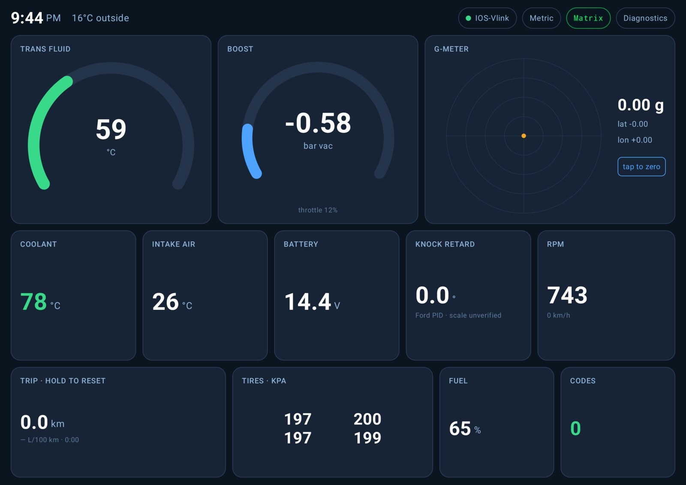
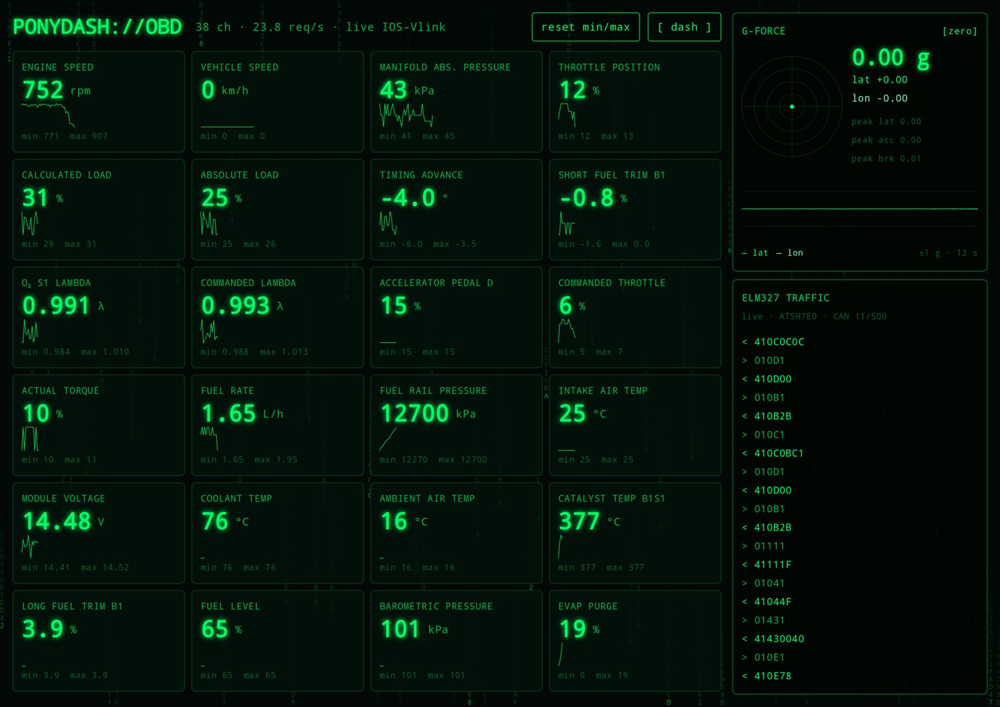

# PonyDash

An Android tablet dashboard that sits under a car's CarPlay screen. CarPlay keeps
maps, music and messages; PonyDash shows the car: live OBD-II data from a
Bluetooth LE adapter, Ford-specific readings, and a G-meter from the tablet's
own accelerometer.

Built for and tested on a 2025 Ford Mustang EcoBoost (S650) with a Vgate
iCar Pro 2S adapter and a OnePlus Pad 3 running LineageOS.



## Matrix view

Every reading the car reports, with sparklines, min/max, a G-force panel and
the raw ELM327 traffic scrolling by.



## Features

- **Dashboard:** transmission temp (or oil temp, on cars that report it), boost,
  G-meter, coolant, intake air, battery, knock retard, RPM/speed, trip
  distance and economy, tire pressures, fuel level and trouble-code count.
  Tiles turn amber/red at warning thresholds.
- **Matrix view:** all ~38 channels at once, each with a sparkline and
  min/max, plus a friction circle, 12-second lateral/longitudinal G graph and
  peak G values.
- **Metric or imperial**, switched from the top bar (°C/°F, kPa or bar/psi,
  km/mi, L/100 km or mpg).
- **Bluetooth LE ELM327** link that finds the adapter's serial service
  on its own, remembers the adapter, and reconnects after drop-outs.
- **Polling by priority:** RPM, speed and manifold pressure every cycle,
  temperatures less often, tire pressures rarely. About 20–24 requests per
  second on an ELM327 v2.3 clone.
- **Diagnostics screen:** supported-PID list, live values, a raw ELM327
  console, and a one-tap probe of Ford mode-22 reads.
- **Simulator** for working on the UI without a car.
- Fullscreen, landscape, keeps the screen on.

## Ford readings (mode 22)

Confirmed on a 2025 Mustang EcoBoost. These are read-only
ReadDataByIdentifier requests.

| Reading | Module (header) | DID | Scale | Status |
|---|---|---|---|---|
| Transmission fluid temp | PCM `7E0` | `1E1C` | raw ÷ 16 = °C | answers; values plausible |
| Knock / spark retard | PCM `7E0` | `03EC` | signed raw ÷ 16 = ° | answers; scale unverified |
| Tire pressure FL / FR / RR / RL | BCM `726` | `2813`–`2816` | raw ÷ 20 = psi | matches the car's own display |
| Engine oil temp | PCM `7E0` | `1310`, `F45C` | — | not supported on this car |

The car reports no MAF (PID `10`), so trip economy uses the engine's fuel
rate (PID `5E`).

## Hardware

- An Android 13+ tablet with Bluetooth LE. GPS is not needed; the G-meter uses
  the accelerometer.
- A Bluetooth LE ELM327 adapter. The Vgate iCar Pro 2S advertises as
  `IOS-Vlink` and uses service `18F0` (notify `2AF0`, write `2AF1`); `FFF0` and
  `FFE0` adapters are also recognised.

The G-meter assumes the screen faces the occupants, with the back of the tablet
toward the front of the car. Tap **zero** once while parked on level ground.

## Build and install

```sh
./gradlew assembleDebug
adb install -r app/build/outputs/apk/debug/app-debug.apk
```

Needs JDK 17+ and the Android SDK (compileSdk 36). On first launch, grant the
Bluetooth permissions, tap the status chip and pick the adapter with the
ignition on.

## Safety

The console sends whatever you type to the adapter. Stick to reads (`01xx`,
`22xxxx`, `AT…`). Don't interact with the tablet while driving.

## License

MIT. See [LICENSE](LICENSE).
